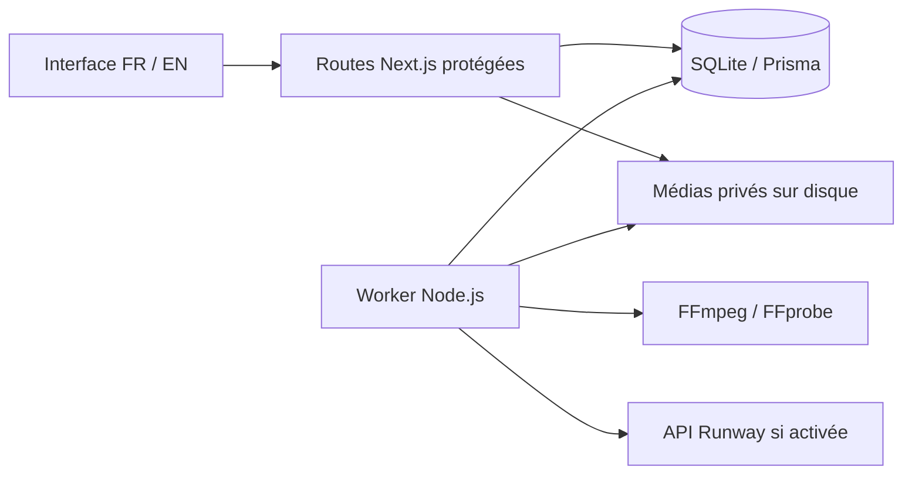

# Architecture et exploitation

## Composants

L'application utilise Next.js 16, React 19, TypeScript, Tailwind CSS 4 et next-intl pour l'interface. Les routes HTTP s'exécutent dans le runtime Node.js. Prisma 6 gère une base SQLite locale ; les fichiers médias restent sur disque, hors du dossier public.

Prisma utilise le moteur JavaScript (`engineType = "client"`) et l'adaptateur officiel `@prisma/adapter-better-sqlite3`. La configuration de la CLI utilise également cet adaptateur pour les migrations. Le projet évite ainsi le téléchargement du moteur Rust Prisma depuis un domaine bloqué dans cet environnement, sans désactiver les contrôles d'intégrité. Le pilote SQLite conserve son propre module natif.

Le worker Node.js traite la file de tâches. Les scripts `dev` et `start` lancent le web et le worker ensemble avec `concurrently`. Pour diagnostiquer chaque processus séparément, utilisez `npm run dev:web` et `npm run worker` dans deux terminaux situés dans le même dossier et avec la même configuration.

FFmpeg et FFprobe sont des exécutables système invoqués sans shell avec des arguments contrôlés. Sharp valide et normalise les images. L'adaptateur Runway isole le contrat du fournisseur des routes et de l'interface.

Les tâches sont conservées en base. Un envoi payant commencé n'est pas rejoué automatiquement lorsqu'on ignore si le fournisseur l'a reçu. Le traitement des tâches dont l'identifiant externe est connu peut reprendre sans envoi d'une seconde génération. La comptabilisation garde séparés l'estimation, la réservation et un coût réel éventuellement rapproché.

## Organisation

| Chemin | Rôle |
| --- | --- |
| `src/app/` | Pages, interface et routes HTTP |
| `src/lib/` | Accès aux données, authentification, validation, médias et tâches |
| `src/lib/providers/` | Adaptateurs des fournisseurs IA |
| `src/lib/export.ts` | Encodage MP4, géométrie, filigrane et métadonnées d'export |
| `src/worker.ts` | Traitement asynchrone des tâches |
| `prisma/schema.prisma` | Modèles de données |
| `prisma/migrations/` | Historique de création et d'évolution de la base |
| `tests/` | Vérifications automatisées sans appel payant |

`Settings` conserve les préférences, le budget et le hash du mot de passe. `Project` regroupe les paramètres d'un projet. `Media` référence un fichier source, un logo ou une vidéo produite. `Job` conserve l'état de la génération, le fournisseur, les paramètres, l'estimation, la réservation de budget et l'identifiant de tâche externe éventuel.

La langue de l'interface et la langue de contenu sont deux paramètres indépendants. Les styles, leurs champs descriptifs par projet et l'option hijab sont des préférences persistées ; ils ne constituent pas encore un moteur de mannequin ou de virtual try-on.

## Exports et ressources

Les résolutions 720, 1080, 1440 et 2160 désignent le petit côté de l'image. Exemples : 1080 en 9:16 donne 1080 × 1920 ; 2160 en 16:9 donne 3840 × 2160 ; 2160 carré donne 2160 × 2160. Le recadrage remplit le format choisi et peut couper les bords de la source.

Les métadonnées distinguent la taille de la source, la taille de l'export et un éventuel agrandissement. La vidéo locale part d'une photo avec un zoom progressif. Elle ne synthétise aucun mouvement réel du produit et reste silencieuse. Un réexport de MP4 conserve une piste audio présente en la réencodant en AAC à 192 kbit/s ; l'ajout de musique et le montage avancé relèvent de la phase 4.

Le traitement limite le parallélisme FFmpeg afin de garder la machine utilisable. Les exports 2160p ou H.265 peuvent être beaucoup plus longs qu'un aperçu 720p et atteindre les délais maximums sur une petite machine. Libérez de l'espace avant de traiter de nombreux clips. Le GPU n'est pas utilisé et aucun modèle ComfyUI/Ollama n'est installé.

## Accès et stockage

Le mot de passe est dérivé avec scrypt. La session est signée avec une clé aléatoire locale conservée dans le dossier de stockage ; les cookies sont HttpOnly et SameSite strict. Les écritures API vérifient l'origine de la requête et les fichiers médias sont servis par des routes authentifiées. Les secrets ne sont pas exposés par l'API des paramètres.

Au premier lancement, la création du mot de passe est ouverte parce qu'aucun propriétaire n'existe encore. Elle doit être effectuée sur l'interface locale avant de publier un accès distant. Le studio reste mono-utilisateur ; ce mécanisme ne remplace pas une administration multi-utilisateur.

`APP_ORIGIN` fixe l'origine publique exacte derrière un proxy, par exemple `https://studio.exemple.fr`, sans barre finale. Cette variable est requise pour les écritures depuis une origine distante : sans elle, seules les origines locales sont acceptées. L'en-tête `Host` doit correspondre à cette origine. Le proxy doit préserver cet en-tête et terminer TLS. Préservez les permissions de la base, des médias et de `session.key`. Ne servez pas directement le dossier `storage/` depuis votre serveur web.

## Sauvegarde

L'export ZIP d'un projet contient `project.json` et les fichiers médias du projet. Il est manuel : il n'existe pas de planificateur de sauvegardes, de stockage distant automatique ni de restauration en un clic. Vérifiez le contenu d'une archive et conservez-la sur un support distinct. Elle peut contenir vos contenus privés ; elle n'inclut pas les clés API de `.env`, la clé de session ni le hash de mot de passe. Une archive individuelle ne remplace pas une copie complète de l'instance.

Pour une copie complète de l'instance, arrêtez le web et le worker puis copiez ensemble la base SQLite et le dossier de stockage. Conservez la configuration serveur à part, de manière sécurisée. Une base et des médias pris à des instants différents peuvent devenir incohérents. Testez une restauration sur une copie isolée avant de compter sur une sauvegarde.

## Déploiement ultérieur

Conservez une seule instance du worker pour ce studio SQLite. Utilisez un système de fichiers local persistant ; ni un stockage éphémère de fonctions serverless ni un partage de fichier SQLite entre plusieurs machines ne conviennent à cette architecture. Exécutez `npm ci`, `npm run db:deploy` et `npm run build`, puis supervisez `npm start`.

Un verrou local dans le stockage empêche deux workers de fonctionner simultanément. Si le worker indique qu'une autre instance existe, arrêtez celle-ci. Ne supprimez manuellement un verrou illisible qu'après avoir vérifié qu'aucun worker n'utilise ce stockage.

La prise en charge de plusieurs utilisateurs, de plusieurs workers, d'un stockage objet et d'une base serveur demandera une évolution dédiée. L'environnement cloud d'une tâche est déjà isolé : le dépôt existant suffit, sans création d'un worktree Git supplémentaire.
