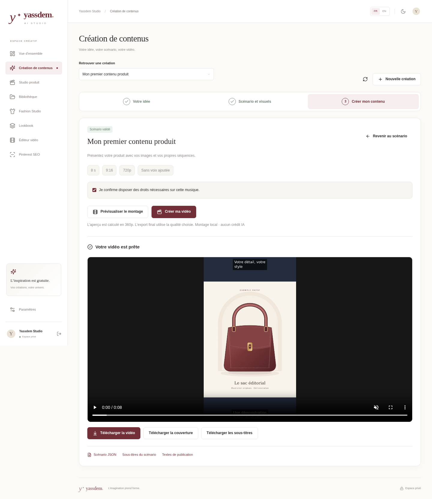

# Créer des contenus avec Yassdem

L'accueil propose **UGC produit**, **Affiliation**, **Histoires et dramas** et **YouTube**. Ces choix ouvrent le même parcours en trois étapes : votre idée, le scénario et les visuels, puis le montage. Le raccourci [une photo → une vidéo](CREATION_RAPIDE.md) reste disponible.

## 1. Préparer votre scénario

Choisissez un objectif, renseignez le sujet et les informations à utiliser, puis la langue, la durée et le format. En affiliation, ajoutez votre lien HTTPS. Pour une fiction, renseignez les personnages et le numéro d'épisode.

**Trame guidée** prépare un scénario à partir de modèles de texte et de vos informations, sans appel IA. **Assistant IA local** utilise Ollama : il est facultatif et nécessite un service et un modèle déjà installés. Le studio n'installe pas de modèle et ne bascule pas vers une API payante.

La préparation propose une accroche, des scènes, une narration, des textes à l'écran, des indications de visuels et un appel à l'action. Le résultat reste une proposition à relire. Pour un produit, fournissez uniquement des caractéristiques vérifiées ; une présentation de style UGC n'est pas un témoignage client inventé.

## 2. Choisir vos visuels et relire

Vous pouvez importer vos images, vidéos MP4 ou fichiers audio, puis les répartir entre les scènes. La bibliothèque permet aussi de réutiliser vos fichiers existants. Sans visuel affecté, une scène devient un **carton texte** ; elle ne génère pas automatiquement une personne, un décor ou une animation IA.

Modifiez les narrations, les textes, les indications, l'ordre et la durée des scènes. Les formats courts peuvent durer jusqu'à deux minutes ; les projets YouTube peuvent atteindre dix minutes, avec 24 scènes maximum. Une scène peut durer de deux à soixante secondes avant adaptation à la voix.

Dans **Voix et présentation**, choisissez :

- **Sans voix ajoutée** : le montage conserve l'audio disponible dans vos séquences.
- **Voix de mon ordinateur** : une voix compatible avec la langue doit être disponible. Sur Windows, elle dépend des voix installées et de l'autorisation d'exécuter le composant local ; Piper peut aussi être configuré séparément. La voix système n'est pas une promesse de voix neuronale naturelle.
- **Ma narration importée** : choisissez un MP3, WAV ou M4A. Enregistrez votre narration en suivant l'ordre du scénario. Le studio ne transcrit pas automatiquement cet audio.

Les sous-titres sont construits depuis votre scénario et calés sur les scènes. Si une voix dépasse leur durée prévue, le montage peut prolonger les scènes dans la limite du format. Vérifiez donc l'aperçu et ajustez les textes si nécessaire.

Vous pouvez ajouter une musique dont vous disposez des droits, régler son volume et reprendre votre logo. Les réglages avancés sont facultatifs.

Cliquez sur **Enregistrer le scénario**, puis **Valider ce scénario**. Toute modification ultérieure demande un nouvel enregistrement et une nouvelle validation. Une autre fenêtre qui a modifié le projet provoque un conflit explicite, sans écraser votre brouillon.

## 3. Créer et télécharger

**Prévisualiser le montage** calcule une vraie vidéo en 360p. **Créer ma vidéo** produit le MP4 final en 720p ou 1080p. Le montage local ne dépense aucun crédit IA. Le temps de traitement dépend de votre ordinateur, de la durée, des visuels et de la voix.

Après traitement, lisez le résultat puis téléchargez la vidéo, sa couverture et les sous-titres SRT. Les exports **Scénario JSON**, **Sous-titres de brouillon** et **Textes de publication** sont aussi disponibles. Le SRT du montage terminé reprend ses durées réelles ; le SRT de brouillon utilise les durées prévues du scénario.

Les mentions d'affiliation sont conservées dans les textes de publication et affichées dans la vidéo, même si vous modifiez les textes de chaque scène. Les fictions sont identifiées comme telles. Le studio ne publie pas automatiquement sur YouTube, TikTok ou Pinterest.

## Réutiliser une création

**Préparer l'épisode suivant** reprend les personnages d'une fiction et augmente le numéro d'épisode. Ajoutez les nouveaux événements avant de préparer le scénario : l'épisode précédent reste conservé. La cohérence visuelle dépend des références que vous affectez ; aucune génération automatique de personnage récurrent n'est revendiquée.

Pour un scénario YouTube validé, **Créer une version courte** prépare un nouveau projet vertical, avec un scénario abrégé de 30 à 60 secondes et les visuels réutilisables. Relisez-le et validez-le avant le montage. La vidéo longue est conservée. Une narration importée pour la vidéo longue est retirée de cette proposition pour que vous puissiez en fournir une adaptée.

Retrouvez vos créations avec le sélecteur ou les projets de l'accueil. La duplication et l'archive ZIP conservent le scénario et les médias référencés. Pour mettre à jour votre ordinateur sans perdre vos projets, suivez le [guide Windows](INSTALLATION_WINDOWS.md#mettre-à-jour-une-installation-existante).

## Voix facultatives avec Piper

L'administrateur peut configurer `CREATOR_PIPER_PATH`, `CREATOR_PIPER_MODEL_FR` et `CREATOR_PIPER_MODEL_EN` dans son `.env`. Chaque modèle ONNX doit être déjà installé avec son fichier `.onnx.json` et une langue correspondante. Vérifiez les licences du logiciel et des poids avant utilisation commerciale. Le studio ne télécharge aucun de ces fichiers et ne change pas la politique d'exécution PowerShell.

Les essais dans le cloud ont produit une vraie voix anglaise avec FFmpeg/flite. La voix française native Windows et les modèles Piper n'ont pas été exécutés réellement sur l'ordinateur de l'utilisateur. Vous pouvez utiliser une narration importée ou le montage sans voix ajoutée.
