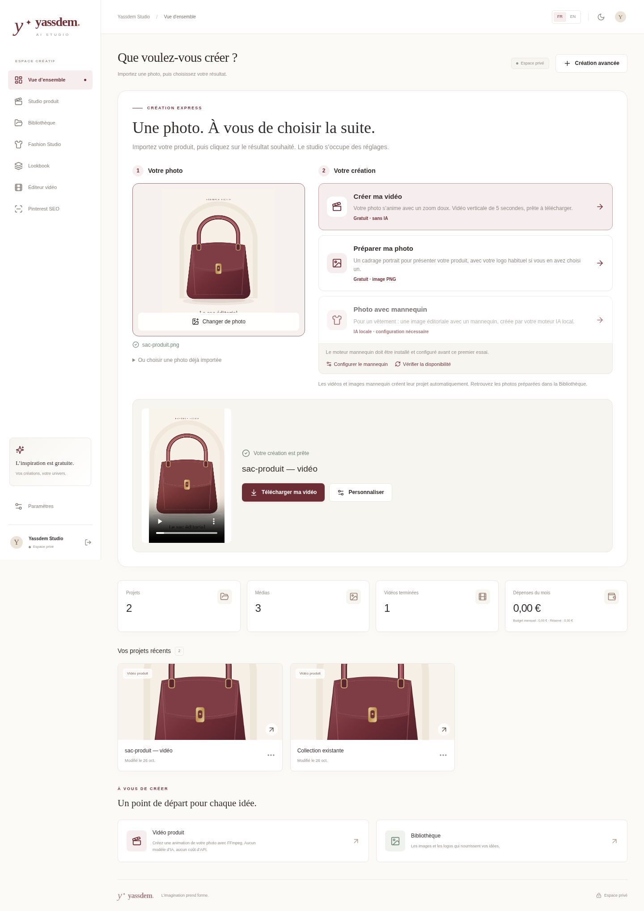

# Une photo, une création

Depuis l'accueil, vous pouvez créer sans nommer un projet ni remplir les réglages techniques.

1. Cliquez sur **Importer une photo**, ou déposez une image dans la zone prévue. Vous pouvez aussi choisir une photo déjà importée. Utilisez une image PNG, JPEG ou WebP de 5 Mo maximum.
2. Choisissez le résultat voulu : **Créer ma vidéo**, **Préparer ma photo** ou **Photo avec mannequin** lorsque ce moteur est prêt.
3. Le résultat apparaît dans la même zone. Lisez la vidéo ou regardez l'image, puis cliquez sur **Télécharger**.

La vidéo rapide dure cinq secondes, au format vertical 9:16, en 720p/H.264. Elle applique un léger zoom sur votre image et reprend votre logo enregistré. Elle ne demande aucun crédit IA. Le projet est créé et nommé automatiquement ; **Personnaliser** ouvre ensuite ses réglages si vous souhaitez les modifier.

**Préparer ma photo** produit une image PNG au cadrage 4:5, avec votre logo enregistré si vous en avez choisi un. Elle conserve la définition disponible après cadrage, sans agrandissement IA. Retrouvez les fichiers dans la bibliothèque. Pour changer le cadrage ou le logo, utilisez l'export d'image de la bibliothèque.

**Photo avec mannequin** crée une image éditoriale à partir d'une photo de vêtement. Elle nécessite un moteur ComfyUI et un workflow compatibles déjà configurés. Le studio vérifie cette disponibilité et propose la configuration si elle manque. Un moteur qui exige plusieurs vêtements ou un portrait ne peut pas être utilisé avec ce raccourci à une seule photo. L'essayage d'un vêtement sur une personne précise reste un parcours distinct dans Fashion Studio, avec les références nécessaires.

La création rapide ne choisit jamais une API payante à votre place, même si un fournisseur payant a été choisi dans les réglages avancés. « Un clic » lance le traitement ; le temps de calcul dépend de votre ordinateur et du moteur utilisé.

Les ateliers avancés restent accessibles dans le menu et par **Création avancée**. Vous pouvez y régler les décors, les coupes, les transitions, la musique, les textes, les logos et les exports. Les réglages enregistrés d'un projet existant ne sont pas remplacés par le parcours rapide.

Pour connaître les outils gratuits adaptés à votre ordinateur, consultez [la sélection GitHub](OUTILS_GRATUITS.md). Le [guide Windows](INSTALLATION_WINDOWS.md#mettre-à-jour-une-installation-existante) explique la mise à jour de votre copie locale en conservant vos projets.
