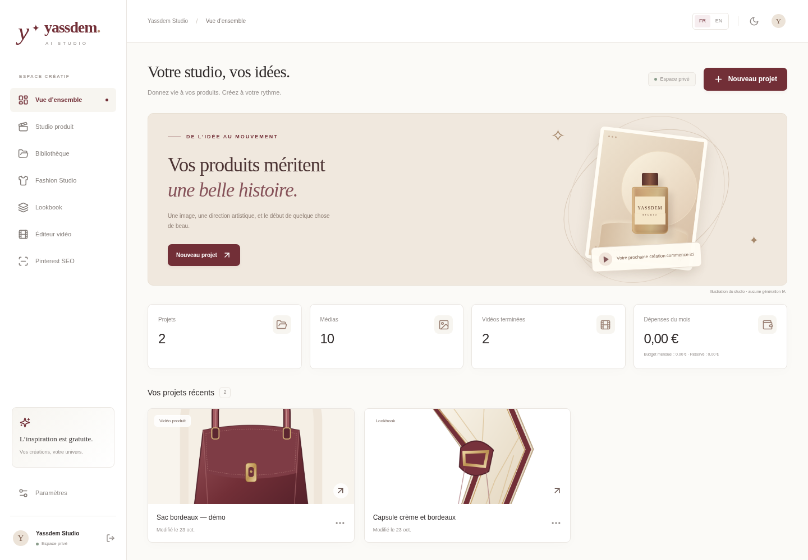
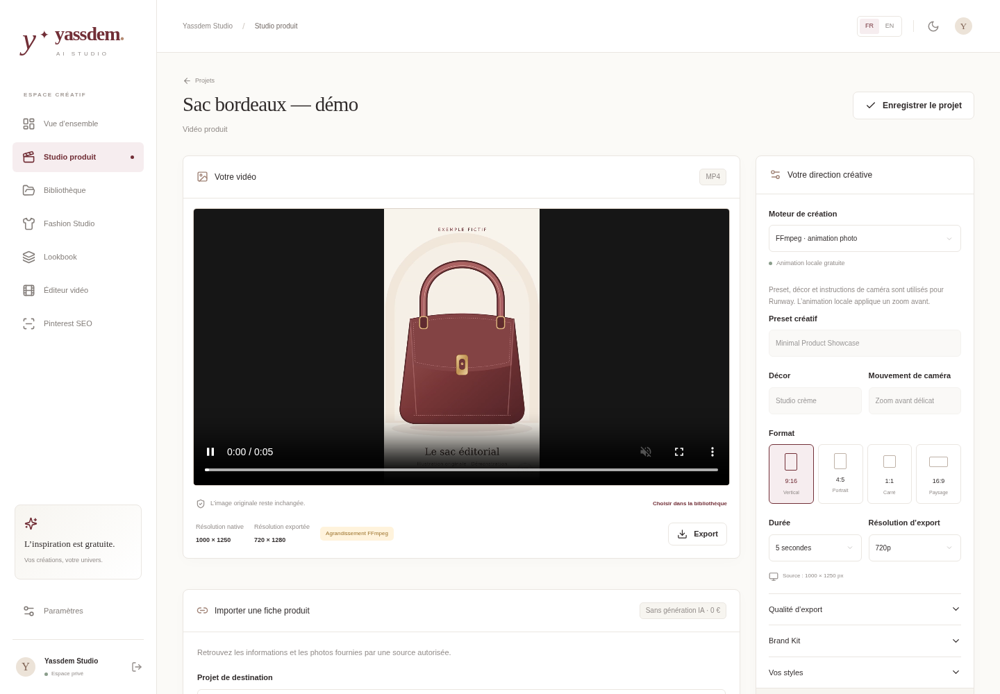

# Découvrir Yassdem AI Studio

Cette visite vous accompagne de la première image au MP4, puis à sa présentation sur Pinterest. Comptez environ dix minutes pour découvrir les écrans, en ajoutant le temps de calcul des images et vidéos sur votre ordinateur.

- [Voir ou télécharger la démonstration vidéo](media/demo-yassdem.mp4).
- [Télécharger les fichiers d'exemple](media/exemples-yassdem.zip), puis extraire le ZIP sur Windows.

Sur GitHub, si la vidéo ne s'affiche pas, cliquez sur **Download raw file** (icône de téléchargement). Ouvrez ensuite `demo-yassdem.mp4` par un double-clic dans votre dossier **Téléchargements**. Utilisez le même bouton pour récupérer le pack ZIP.

La démonstration utilise des illustrations de produits et de vêtements fictifs. Les vidéos et les planches sont réellement calculées par le studio avec ses fonctions locales, sans appel à un modèle IA. Le budget API reste à **0 €**. Le fichier `LISEZMOI.txt` du pack décrit les exemples.

Les projets filmés ont été préparés dans une instance séparée pour cette visite. Pour les reproduire sur votre ordinateur, extrayez le pack, importez les fichiers placés à sa racine et suivez les étapes ci-dessous. Le dossier `resultats/` contient aussi les véritables exports d'exemple. La vidéo dure environ **2 min 37 s**, avec des légendes françaises et une musique originale, sans voix off.

Gardez la fenêtre PowerShell du studio ouverte pendant vos essais. Si vous découvrez encore l'installation, suivez d'abord le [guide Windows](INSTALLATION_WINDOWS.md), puis ouvrez le studio avec l'adresse indiquée par son terminal et connectez-vous.

## Vos points de repère

La navigation se trouve à gauche. Sur un écran étroit, ouvrez le menu pour la retrouver. Les repères ci-dessous sont arrondis à la seconde dans la vidéo ; le nom de chaque écran ouvre aussi sa capture.

| Repère vidéo | Écran | Ce que vous découvrez |
| --- | --- | --- |
| **00:06** | [Vue d'ensemble](media/demo-01-overview.png) | Projets récents, médias, tâches et dépenses |
| **00:14** | [Studio produit](media/demo-02-product.png) | Une image animée en véritable MP4 avec FFmpeg |
| **00:29** | [Bibliothèque](media/demo-07-library.png) | Les fichiers importés et l'aperçu d'image avec logo |
| **00:44** | [Fashion Studio](media/demo-03-fashion.png) | Une planche de vêtements et des profils réutilisables |
| **01:08** | [Lookbook](media/demo-08-lookbook.png) | Une collection de looks et ses variantes |
| **01:16** | [Éditeur vidéo](media/demo-04-editor.png) | Clips, texte, musique, aperçu composé et export |
| **01:38** | [Pinterest SEO](media/demo-05-pinterest.png) | Titres, descriptions, mots-clés et contenus FR/EN |
| **02:02** | [Paramètres](media/demo-06-settings.png) | Langues, apparence, marques, budget et sauvegardes |

## 1. Prendre vos marques

Dans **Vue d'ensemble**, observez les projets récents, le nombre de médias, les vidéos terminées et le budget du mois. Les raccourcis vous conduisent aux différents ateliers.

Dans l'en-tête, cliquez sur **EN**, puis sur **FR** : les menus changent de langue. Les textes que vous avez saisis restent les vôtres. Vous pouvez donc utiliser le studio en français tout en préparant un contenu Pinterest en anglais.

Ouvrez **Paramètres** pour choisir une apparence **Claire** ou **Sombre**. Cliquez sur **Enregistrer** après vos changements. Laissez le **Plafond mensuel en EUR** à zéro pour cette visite.

## 2. Préparer la bibliothèque et votre signature

Dans **Bibliothèque**, cliquez sur **Importer des médias** et choisissez `sac-produit.png`, `haut.png`, `pantalon.png` et `accessoire.png` du pack extrait. Vous pourrez réutiliser ces images dans plusieurs projets.

Pour importer le logo avec le bon rôle, ouvrez **Paramètres → Brand Kit → Ajouter un logo**, puis sélectionnez `logo-yassdem.png`. Choisissez votre logo par défaut, sa position et sa taille, puis cliquez sur **Enregistrer**. Vous pourrez aussi choisir un autre logo, ou aucun logo, lors d'un export.

Le panneau **Identités de marque** permet de conserver plusieurs signatures : **Nouvelle identité**, nom et réglages, puis **Enregistrer l'identité**. **Appliquer aux préférences** prépare les prochains projets ; les projets existants gardent leurs propres choix.

## 3. Créer votre première vidéo produit

1. Dans **Vue d'ensemble**, cliquez sur **Nouveau projet** ou **Créer ma première vidéo**. Nommez-le **Sac bordeaux — démo**, puis cliquez sur **Créer le projet**.
2. Dans **Studio produit**, choisissez `sac-produit.png` avec **Choisir dans la bibliothèque**.
3. Choisissez **FFmpeg · animation photo** comme **Moteur de création**, un format **9:16**, une durée de **5 secondes**, une résolution **720p** et le codec **H.264**. Ces réglages conviennent pour un premier essai rapide.
4. Dans le **Brand Kit** du projet, ajoutez votre logo si vous souhaitez un filigrane. Les réglages permettent de choisir sa position, son opacité et sa présence au début, à la fin ou sur toute la vidéo.
5. Cliquez sur **Créer gratuitement**. La tâche apparaît dans l'historique ; attendez la fin de son traitement.
6. Ouvrez **Voir la vidéo**, lancez la lecture, puis utilisez **Télécharger le MP4**.

Vous obtenez une vraie vidéo avec un léger zoom sur l'image. Ce mode local conserve votre illustration : il ne crée pas de nouveaux mouvements du produit, ne change pas son décor et ne réalise pas de génération IA. Les presets, décors et instructions de caméra concernent les moteurs IA compatibles, notamment Runway.

Le studio distingue les dimensions de la source et celles de l'export. Passer une petite image en 4K l'agrandit ; cela ne transforme pas la source en création native 4K.

## 4. Préparer aussi une image avec votre logo

Retournez dans **Bibliothèque** et descendez jusqu'à **Export d'image**. Choisissez une source, le cadrage, le fichier PNG/JPEG/WebP et votre logo. Cliquez sur **Prévisualiser les réglages** pour voir réellement le cadrage et le filigrane avant de créer le fichier.

Quand le résultat convient, cliquez sur **Créer l'image**, puis **Télécharger**. Vous pouvez conserver les dimensions natives ou choisir le côté long de 3 840 pixels. L'aperçu reste plus petit que l'export final et ne crée pas de média enregistré.

## 5. Composer un look et une collection

1. Ouvrez **Fashion Studio**, choisissez **Nouvelle collection** et créez **Capsule crème et bordeaux**.
2. Dans **Composer un look**, nommez le look **Première silhouette**. Utilisez **Choisir dans la bibliothèque**, sélectionnez le haut, le pantalon et l'accessoire, puis **Utiliser cette sélection**.
3. Explorez **Styles à combiner**, la palette et les accessoires. Vous pouvez associer plusieurs styles ; aucun style n'est imposé. Cliquez sur **Enregistrer le look**.
4. Dans **Donner forme au look**, choisissez **Planche de collection**, puis **Créer ma planche**.
5. Comparez **Pièces originales** et **Votre résultat**, puis utilisez **Télécharger l'image**.
6. Ouvrez **Lookbook**, consultez **Ma collection** et essayez **Créer une variante**. Changez un réglage et enregistrez la variante pour garder plusieurs propositions.

La planche assemble vos images de vêtements. Elle ne montre pas un mannequin portant les pièces. **Image éditoriale IA** et **Essayage virtuel** sont deux fonctions distinctes qui demandent un service ComfyUI et des workflows configurés.

L'onglet **Mes mannequins** permet de créer un profil réutilisable avec carnation, morphologie, taille, coiffure et pose. L'option hijab est indépendante du style. Enregistrer ce profil ne génère pas de portrait ; le mannequin reste facultatif pour une planche locale.

Vous pouvez enregistrer des **Styles réutilisables** dans les paramètres, puis choisir **Ajouter ce style au look** dans Fashion Studio. Enregistrez ensuite le look pour conserver la combinaison. Enfin, **Animer cette image** ouvre son résultat dans le Studio produit, où vous choisirez le moteur vidéo.

## 6. Monter et habiller vos clips

1. Ouvrez **Éditeur vidéo** et créez un **Nouveau montage** nommé **Capsule — présentation**.
2. Cliquez sur **Ajouter un clip** et choisissez le MP4 créé au cours de la visite. Vous pouvez ajouter un second clip pour essayer les transitions.
3. Réglez **Début (s)** et **Fin (s)**, puis utilisez **Monter le clip** ou **Descendre le clip** pour changer l'ordre. Choisissez une **Coupe franche** ou un **Fondu enchaîné**.
4. Cliquez sur **Ajouter un texte** et saisissez, par exemple, **Une couleur, une nouvelle allure**. Définissez ses horaires et sa position.
5. Pour essayer le son, vous pouvez importer `musique-demo.wav` du pack après lecture de son `LISEZMOI.txt`. Ajustez le volume et confirmez vos droits sur la piste. Vous pouvez aussi conserver **Sans musique ajoutée**.
6. Choisissez **Prévisualiser le montage**. Lisez cet aperçu composé avant de lancer l'export final.
7. Quand le résultat convient, choisissez 720p ou 1080p en H.264, puis **Exporter le montage**. Téléchargez le MP4 et sa couverture.

L'aperçu est un vrai montage à 360p : coupes, textes, transitions, son et logo sont calculés. Il préserve les réglages de l'export final. Si vous modifiez le montage, calculez un nouvel aperçu pour contrôler la nouvelle version.

## 7. Préparer les textes Pinterest

Dans **Pinterest SEO**, sélectionnez votre projet **Sac bordeaux — démo**. Renseignez le nom du produit, sa catégorie et quelques caractéristiques. Pour cette visite, précisez qu'il s'agit d'un exemple fictif ; pour vos contenus réels, utilisez uniquement des faits vérifiés.

Choisissez **Français + anglais**, puis **Rédaction assistée locale** et cliquez sur **Préparer et enregistrer**. Chaque langue propose trois titres, deux descriptions, des mots-clés, un appel à l'action, un texte alternatif et un tableau Pinterest.

Relisez et modifiez les propositions, puis cliquez sur **Enregistrer les modifications**. Essayez **Copier**, **Tout copier**, **JSON complet** ou **CSV Pinterest**. Le CSV demande encore une URL publique de média et une vérification avant import dans Pinterest. Le studio ne publie pas automatiquement sur les réseaux sociaux.

Le mode local utilise des modèles de texte, sans IA. **Modèle local Ollama** est une option séparée qui demande un service et un modèle installés. Si vous ajoutez un lien affilié à un contenu réel, conservez une mention publicitaire explicite.

## 8. Retrouver et sauvegarder votre travail

Enregistrez vos réglages dans chaque atelier. Vous retrouverez les projets dans **Vue d'ensemble** et leurs fichiers dans **Bibliothèque**.

Ouvrez **Paramètres → Sauvegarde**, puis cliquez sur le **nom du projet** à conserver. Le studio télécharge une archive ZIP avec les paramètres et médias référencés. Dans Lookbook, **Exporter la collection ZIP** permet aussi d'emporter la collection sélectionnée.

Conservez cette archive sur votre ordinateur ou un support distinct. Le dépôt GitHub sauvegarde le code ; l'archive de projet sauvegarde vos créations. Une copie complète de l'instance inclut aussi sa base et son stockage selon le [guide d'exploitation](ARCHITECTURE.md#sauvegarde). La restauration d'un ZIP de projet reste manuelle.

## À explorer après la visite

| Fonction | Ce qu'elle apporte | Ce qui reste nécessaire |
| --- | --- | --- |
| **Importer une fiche produit** dans Studio produit | Informations et jusqu'à trois images d'une source Shopify ou JSON autorisée | Autorisation du marchand et accès réseau compatible ; les pages HTML ne sont pas analysées |
| **Modèles et paramètres** | Catalogue des moteurs et réglages supportés | La présence dans le catalogue ne garantit pas l'accès du compte au modèle |
| **Runway / Replicate** | Générations IA distantes | Configuration serveur, fournisseur activé, budget suffisant et confirmation explicite de la dépense |
| **ComfyUI** | Image éditoriale et essayage virtuel dans des workflows séparés | Service, modèles et workflows compatibles ; ressources matérielles adaptées |
| **Ollama** | Rédaction avec un modèle local | Service et modèle installés séparément |

La visite filmée montre le fonctionnement local. Elle ne prouve pas une génération avec un fournisseur IA réel ni l'import depuis une boutique réelle. Les vérifications effectivement réalisées sont consignées dans [VALIDATION.md](VALIDATION.md).
